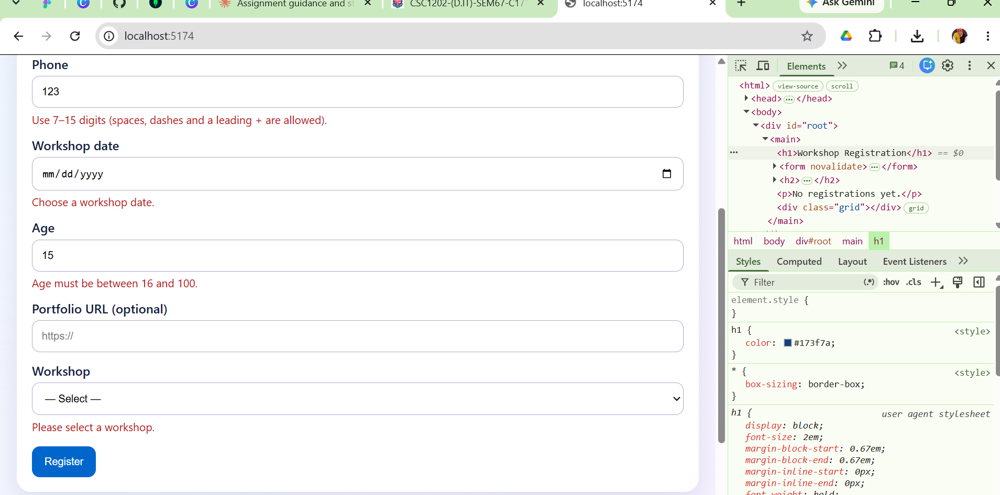
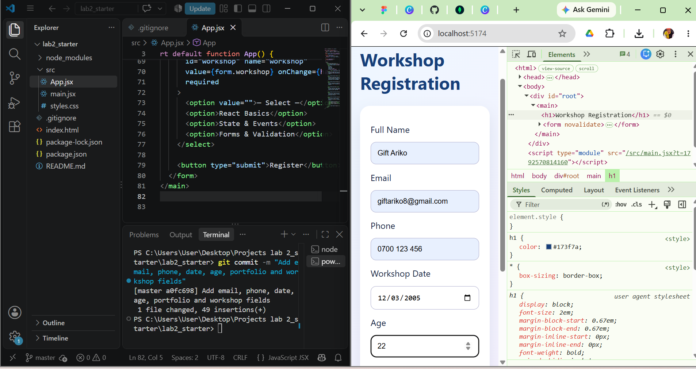

# Workshop Registration (Lab 2)

A React + Vite app for practising controlled inputs, validation and immutable state updates.

## Setup
1. Install Node.js (v18 or newer) and VS Code.
2. Open this folder in VS Code.
3. Run `npm install`
4. Run `npm run dev`
5. Open the local URL shown in the terminal (usually http://localhost:5173).

## Features
- Every input is controlled by React state (text, email, tel, date, number, url, select)
- Invalid submissions are blocked, with a specific error message beside each field
- Valid registrations appear immediately and the form clears with a success message
- Registrations are added with the spread operator and removed with `filter()`, so the original array is never mutated
- Responsive layout and accessible labels

## Screenshots

